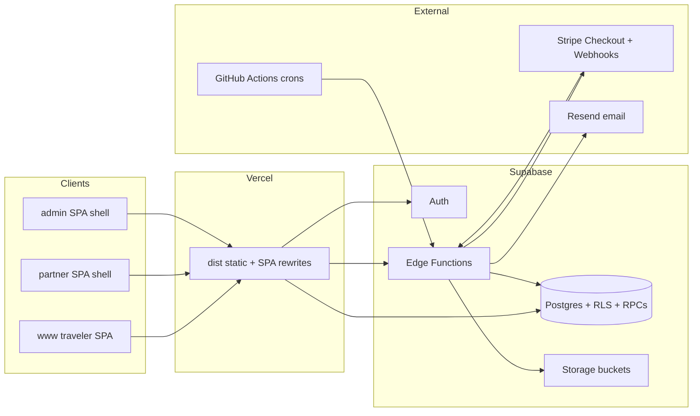
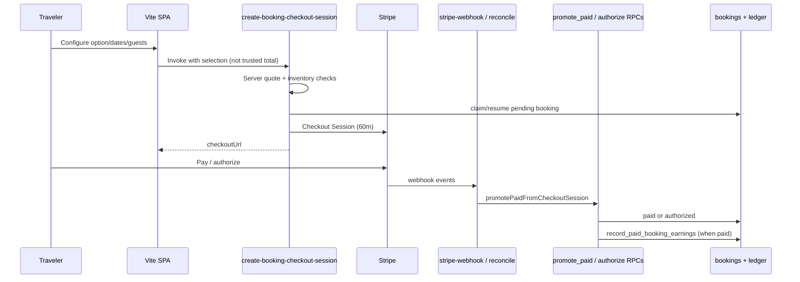

# 12 — System Architecture (as implemented)

---

## High-level

---

## Host & routing

| Host | Shell | Entry |
|------|-------|-------|
| `traverion.com` / `www` | Traveler `App.tsx` | Page keys via `parsePathname` |
| `partner.traverion.com` | `SupplierLayout` | `/partner/*` sections |
| `admin.traverion.com` | `AdminGate` / `AdminShell` | Staff login + tabs |

No React Router — history API + page state in App.

---

## Authoritative booking systems

**Instant Book:** unpaid pending does **not** occupy (mig 257).  
**Stay R2B:** manual capture; authorized occupies; host accept captures; expire job releases.

---

## Availability

| Family | Mechanism |
|--------|-----------|
| Tours | Departure slot capacity; paid+authorized guests; holds rules in booking-hold |
| Stays | Night ranges; blocked nights; occupied by paid+authorized (and R2B authorized) |

Public calendars include holds where SQL says so (historical migrations 079/105 era; Instant pending behavior updated by 257).

---

## Payments & finance

- **MoR:** Platform Stripe Checkout  
- **Promote:** Atomic RPC after amount/currency/listing gates  
- **Orphan/conflict:** Auto refund in promote paths  
- **Guest cancel refund:** Policy + ledger instruction; **manual** Stripe execute  
- **Earnings:** `record_paid_booking_earnings` / reverse / shrink  
- **Payouts:** Admin record (no Connect automation in product)

---

## Notifications

Edge `notify-customer-booking` and `notify-supplier-event` with idempotency keys.  
Reminders via `send-booking-reminders` + GH Actions.  
**Booking row is source of truth; email is best-effort.**

---

## Security boundaries

| Boundary | Enforcement |
|----------|-------------|
| Traveler data | Auth UID + booking ownership RPCs/RLS |
| Supplier data | listing ownership + team roles RLS |
| Admin | JWT role + `public.admin` + edge assertAdmin |
| Webhooks | Stripe signature + event table lock |
| Storage | Bucket policies for listing/verification/logos |

---

## Complexity / duplication notes

| Topic | Observation |
|-------|-------------|
| Cart | Soft-retired multi-item; residual open-checkout page vs Trips |
| Dual promote triggers | Webhook + reconcile (promote short-circuit protects) |
| Commercial freeze | Best-effort on create |
| Large migration history | Iterative honesty > greenfield rewrite |
| Orphan PartnerHelpPage | Dead file |
| Analytics stub | Not productized |

**Recommendation:** Prefer consolidating traveler “open payment” into Trips only; keep promote single helper (already); avoid inventing a second booking engine for stays (already shared).
